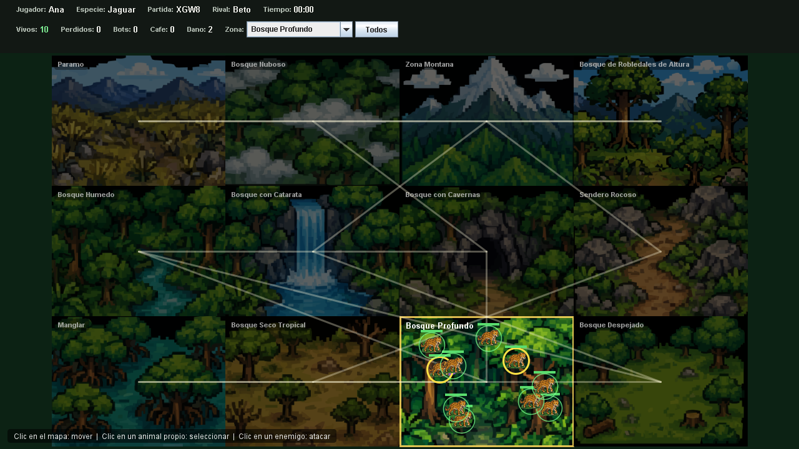
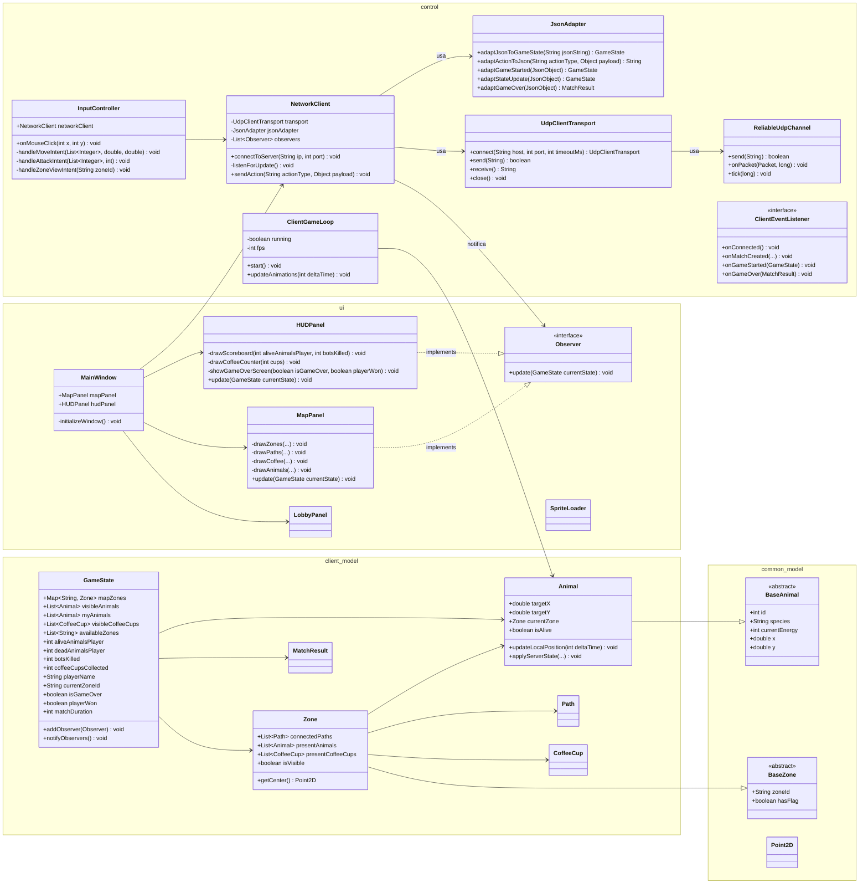
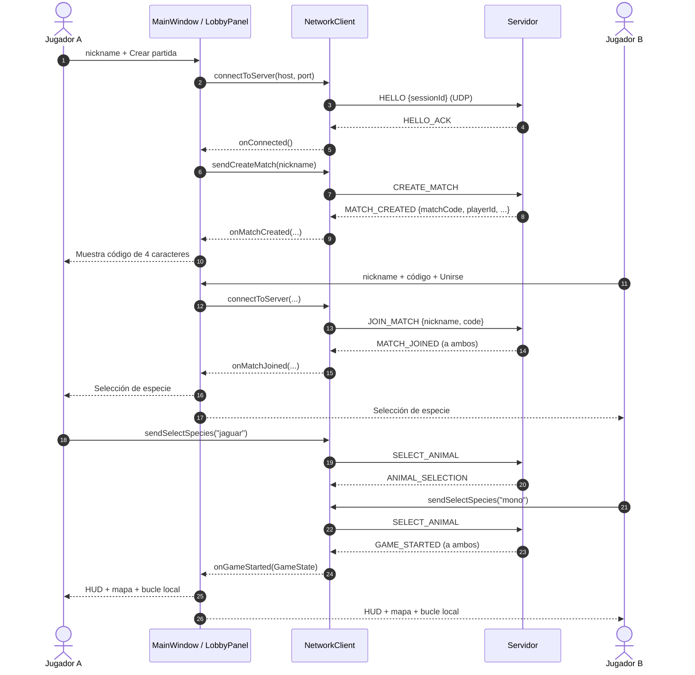
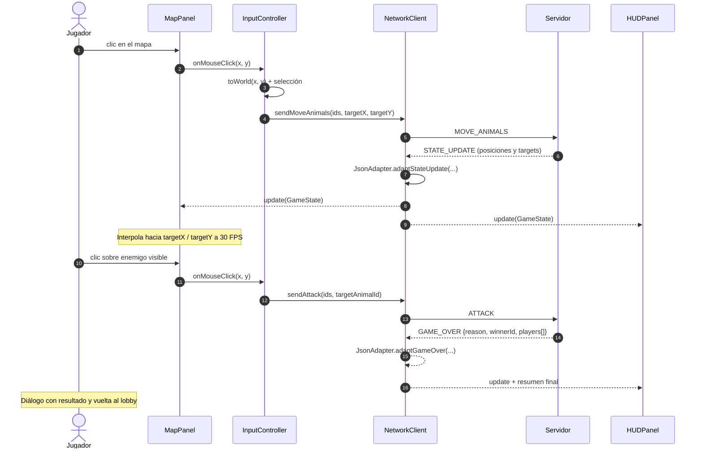

# Jungle Attack — Cliente

Cliente de escritorio del juego **Jungle Attack** para el Caso 2 de Programación Orientada a Objetos. Está construido con **Java 17 + Swing**, se comunica con el servidor por **UDP confiable** (secuencia, ACK, retransmisión y heartbeat) usando **JSON de un mensaje por datagrama** y dibuja el estado que el servidor le autoriza a ver.

> **Estado actual:** compila, se empaqueta y **22 pruebas unitarias/de integración pasan**.
>
> ```text
> Tests run: 22, Failures: 0, Errors: 0, Skipped: 0
> BUILD SUCCESS
> ```



> La captura se generó con datos reales de una partida (`GAME_STARTED` y `STATE_UPDATE` capturados del servidor), no con datos inventados.

---

## 1. Alcance

Este repositorio contiene **solo el cliente**. El servidor vive en un repositorio aparte; ambos proyectos se actualizaron al mismo transporte **UDP confiable** para poder comunicarse.

El cliente:

- Se conecta al servidor por UDP confiable y respeta el protocolo JSON real.
- Crea o se une a una partida mediante un código de 4 caracteres.
- Permite elegir una de las 7 especies nativas.
- Dibuja las 12 zonas, los caminos, la niebla de guerra, los animales, las tazas de café y las banderas.
- Interpola el movimiento localmente para que se vea fluido sin pedir más mensajes.
- Envía únicamente **intenciones** (`MOVE_ANIMALS`, `ATTACK`, `VIEW_ZONE`); nunca calcula reglas ni decide el resultado.
- Muestra el HUD, los errores del servidor y el resumen final de la partida.

---

## 2. Requisitos y ejecución

### Requisitos

- **JDK 17** o superior.
- **Maven 3.9+**.
- No hace falta instalar Gson ni JUnit: Maven los descarga.

### Compilar y probar

```bash
cd Client
mvn -B test
```

### Generar el JAR ejecutable

```bash
mvn -B package
```

El plugin Shade genera un único archivo:

```text
target/jungle-attack-client.jar
```

### Ejecutar

Primero arranca el servidor (en su propio repositorio):

```bash
java -jar Server/target/jungle-attack-server.jar 8080
```

Luego el cliente:

```bash
java -jar Client/target/jungle-attack-client.jar
```

También se puede ejecutar desde el IDE con la clase `client.ClientMain`.

En el lobby se configuran:

| Campo | Valor por defecto |
|---|---|
| Nickname | `Jugador` |
| Servidor | `localhost` |
| Puerto | `8080` |
| Código | vacío (solo para unirse) |

### Jugar con el rival en otra red (Tailscale)

El cliente necesita alcanzar la IP de la máquina donde corre el servidor. Como
Internet normalmente no enruta hasta una PC doméstica, la opción más simple es
**Tailscale** (red privada tipo malla, sin abrir puertos ni tocar el router).

1. Instalar Tailscale en las dos computadoras desde
   <https://tailscale.com/download> e iniciar sesión con la **misma cuenta**,
   para que ambas queden en la misma red privada.
2. En la máquina servidor: `tailscale ip -4` para obtener la IP `100.x.y.z`,
   permitir UDP `8080` en el Firewall de Windows y arrancar el servidor.
3. En este cliente: abrir el JAR y escribir en **Servidor** la IP `100.x.y.z`
   de la máquina servidor; **Puerto** `8080`.
4. Un jugador pulsa **Crear partida**; el otro escribe el código y pulsa
   **Unirse**.

El jugador que solo juega necesita únicamente `jungle-attack-client.jar` y
Java 17+; no necesita el repositorio del servidor. El detalle completo de la
configuración está en el `README.md` del servidor.

Si prefieren no instalar Tailscale, el servidor puede publicar el puerto UDP con
`playit.gg`. En ese caso **Servidor** es el dominio `algo.ply.gg` y **Puerto** es
el puerto externo que muestra la *Allocation* del túnel (no 8080). Los pasos
están en el `README.md` del servidor.

---

## 3. Cómo jugar

1. **Crear partida:** escribe un nickname y pulsa **Crear partida**. El servidor responde con un código de 4 caracteres.
2. **Unirse:** el segundo jugador escribe el mismo código y pulsa **Unirse**.
3. **Elegir especie:** cada jugador elige una especie distinta. El servidor quita la especie del rival de la lista.
4. **Jugar:**
   - Clic sobre un animal propio para seleccionarlo o quitarlo de la selección.
   - Clic en el mapa para mover los animales seleccionados.
   - Clic sobre un animal enemigo visible para atacarlo.
   - El combo **Zona** del HUD cambia la zona que se está mirando (`VIEW_ZONE`).
   - El botón **Todos** selecciona todos los animales vivos.
5. **Ganar:**
   - Tocar la bandera del rival, o
   - dejar al rival sin animales (`PACK_DEFEATED`).

Si el rival se desconecta, el servidor termina la partida (`DISCONNECT`) y el cliente muestra el resultado.

---

## 4. Arquitectura

### 4.1 Paquetes

| Paquete | Contenido | Rol |
|---|---|---|
| `constants` | `IConstants` | Valores fijos del juego, la ventana y la red. |
| `common.model` | `BaseAnimal`, `BaseZone`, `Point2D` | Modelo compartido con el servidor. |
| `common.message` | `Message`, `MessageType` | Sobre JSON y catálogo de tipos de mensaje. |
| `client.model` | `Animal`, `Zone`, `Path`, `CoffeeCup`, `GameState`, `MatchResult` | Estado del cliente y modelo visual. |
| `control` | `NetworkClient`, `JsonAdapter`, `InputController`, `ClientGameLoop`, `ClientEventListener` | Red, adaptación, entrada y bucle local. |
| `control.udp` | `UdpClientTransport`, `ReliableUdpChannel`, `UdpProtocol` | Transporte UDP confiable: handshake, framing, ACK, retransmisión y heartbeat. |
| `ui` | `MainWindow`, `MapPanel`, `HUDPanel`, `LobbyPanel`, `Observer`, `SpriteLoader` | Interfaz Swing y observadores. |
| `client` | `ClientMain` | Punto de entrada. |

### 4.2 Separación de responsabilidades

```text
ClientMain
 └── MainWindow ──────────────► LobbyPanel
      │                         MapPanel  ◄── Observer
      │                         HUDPanel  ◄── Observer
      ├── NetworkClient ──────► JsonAdapter ──► GameState / MatchResult
      │        │
      │        └── ClientEventListener ──► MainWindow
      ├── InputController ────► NetworkClient
      └── ClientGameLoop ─────► Animal.updateLocalPosition(...) ──► MapPanel.repaint()
```

- `NetworkClient` no conoce Swing salvo para despachar al EDT.
- `JsonAdapter` no conoce la red ni la interfaz: solo transforma JSON ↔ modelo.
- `MainWindow` coordina las vistas y el ciclo de la partida.
- `MapPanel` y `HUDPanel` solo dibujan el `GameState` que reciben.
- `InputController` traduce clics y gestos en mensajes del protocolo.
- `ClientGameLoop` solo interpola animaciones locales.

### 4.3 Hilos

| Hilo | Responsabilidad |
|---|---|
| **EDT de Swing** | Construye y actualiza toda la interfaz, ejecuta el adaptador y notifica a los observadores. |
| `client-connector` (daemon) | Abre el canal UDP y completa el handshake `HELLO` / `HELLO_ACK` sin bloquear el EDT. |
| `udp-client-receiver` (daemon) | Recibe datagramas, los decodifica y entrega en orden los mensajes JSON al `inbox`. |
| `udp-client-housekeeping` (daemon) | Reenvía lo no confirmado, envía `PING` cada 2 s y cierra la conexión tras 15 s de inactividad. |
| `client-listener` (daemon) | Toma los mensajes JSON del `inbox` y los despacha al EDT con `SwingUtilities.invokeLater`. |
| `Swing Timer` | Bucle visual a `IConstants.refreshRate` FPS para interpolar animales. |

El envío pasa por `ReliableUdpChannel`, que numera los mensajes, los guarda hasta recibir ACK y protege el estado con un lock; puede originarse en un botón del HUD, en el lobby o en un clic del mapa.

### 4.4 Flujo general

1. `ClientMain` crea `NetworkClient` y `MainWindow` dentro del EDT.
2. El lobby pide conectar; `NetworkClient` abre el canal UDP, completa `HELLO` / `HELLO_ACK` y avisa `onConnected`.
3. Se envía `CREATE_MATCH` o `JOIN_MATCH`.
4. El servidor responde `MATCH_CREATED` / `MATCH_JOINED`; el lobby muestra el código o la selección de especie.
5. Al elegir especie se envía `SELECT_ANIMAL`. Cuando ambos eligieron, llega `GAME_STARTED`.
6. `JsonAdapter` construye el `GameState` inicial (mapa, zona inicial, pack).
7. Cada `STATE_UPDATE` se adapta al EDT, se notifica a los observadores y se refresca el HUD/mapa.
8. El bucle local interpola posiciones hacia `targetX` / `targetY`.
9. `GAME_OVER` construye un `MatchResult` y muestra el resumen; luego se vuelve al lobby.

---

## 5. Diagrama de clases



---

## 6. Diagrama de secuencia

### 6.1 Conexión, lobby e inicio de partida



### 6.2 Movimiento, ataque y fin de partida



---

## 7. Patrones de diseño y POO

### Observer

- `GameState` es el **sujeto**: mantiene una lista de `Observer` y los notifica con `notifyObservers()`.
- `MapPanel` y `HUDPanel` son observadores concretos; `MainWindow` también observa para sincronizar el control.
- `NetworkClient` guarda su propia lista de observadores y la inyecta en cada `GameState` nuevo. Así las vistas se suscriben una sola vez y siguen recibiendo actualizaciones aunque el estado se reemplace.
- `ClientEventListener` cubre los eventos que **no** son estado (lobby, inicio, fin, errores y desconexión).

### Adapter

`JsonAdapter` adapta el JSON del servidor al modelo del cliente:

- `adaptGameStarted(JsonObject)` → mapa, zona inicial, pack y especie.
- `adaptStateUpdate(JsonObject)` → zona vista, animales, café, estadísticas y bandera.
- `adaptGameOver(JsonObject)` → `MatchResult`.
- `adaptActionToJson(...)` → sobre JSON listo para enviar.
- `adaptJsonToGameState(String)` mantiene el contrato del diagrama y decide según `type`.

El adaptador **reutiliza los objetos `Animal` por `id`** y la topología del mapa. Eso permite que la interpolación continúe sin saltos entre actualizaciones.

### Herencia y polimorfismo

- `Animal extends BaseAnimal` y `Zone extends BaseZone`.
- `BaseAnimal` y `BaseZone` son abstractas y concentran lo compartido con el servidor.
- `MapPanel` y `HUDPanel` implementan `Observer`, por lo que `NetworkClient` los trata de forma polimórfica.

### Otros recursos de Java

- `record` para DTOs internos del lobby (`CreateRequest`, `JoinRequest`, `SpeciesItem`, `ZoneItem`).
- `switch` con expresiones para traducir nombres de especies y motivos de fin.
- Genéricos en `List`, `Map` y `Supplier`.
- `CopyOnWriteArrayList` para observadores seguros entre hilos.
- `AtomicBoolean` para no duplicar el aviso de desconexión.

---

## 8. Protocolo JSON

### 8.1 Formato en el cable

El transporte es **UDP confiable**. Cada mensaje del juego viaja en el payload de un datagrama con esta cabecera de 12 bytes:

```text
+--------+---------+------+---------+---------+------------------+
| magic  | version | tipo | seq (4) | ack (4) | payload (JSON)   |
| 2 byte | 1 byte  | 1 b  |         |         |                  |
+--------+---------+------+---------+---------+------------------+
```

- `magic`: `0x4A41` (`"JA"`), para descartar tráfico ajeno.
- `version`: `1`.
- `tipo`: `DATA`, `ACK`, `HELLO`, `HELLO_ACK`, `BYE`, `PING` o `PONG`.
- `seq`: número de secuencia del emisor.
- `ack`: último `seq` recibido en orden (ACK acumulativo).
- `payload`: para `DATA`, un objeto JSON UTF-8 de una sola línea; para `HELLO`, el id de sesión de 8 bytes; el resto va vacío.

El sobre JSON no cambió:

```json
{
  "type": "MOVE_ANIMALS",
  "payload": {
    "animalIds": [3, 4, 7],
    "targetX": 812,
    "targetY": 344
  }
}
```

`Message` envuelve el payload y `MessageType` centraliza los tipos. Un tipo desconocido no rompe al cliente: se ignora.

**Fiabilidad sobre UDP:** `ReliableUdpChannel` numera los mensajes, confirma hasta el último recibido en orden, retransmite cada 150 ms lo que no tiene ACK, descarta duplicados y guarda los adelantados hasta que llega el faltante. Si no hay actividad durante 15 s, la conexión se cierra y `NetworkClient` avisa `onDisconnected`. El límite de payload es 60 000 bytes por datagrama.

### 8.2 Cliente → Servidor

| Tipo | Campos | Efecto |
|---|---|---|
| `CREATE_MATCH` | `nickname` | El servidor responde `MATCH_CREATED`. |
| `JOIN_MATCH` | `nickname`, `code` | El servidor responde `MATCH_JOINED` a ambos. |
| `SELECT_ANIMAL` | `species` | `ANIMAL_SELECTION`; si ambos eligieron, `GAME_STARTED`. |
| `MOVE_ANIMALS` | `animalIds[]`, `targetX`, `targetY` | El servidor calcula la ruta y la publica en `STATE_UPDATE`. |
| `ATTACK` | `animalIds[]`, `targetAnimalId` | Registra la orden de ataque. |
| `VIEW_ZONE` | `zoneId` | Devuelve un `STATE_UPDATE` con esa zona. |

### 8.3 Servidor → Cliente

| Tipo | Campos principales | Uso en el cliente |
|---|---|---|
| `MATCH_CREATED` | `matchCode`, `playerId`, `playerName`, `playerNumber` | Muestra el código y espera al rival. |
| `MATCH_JOINED` | `matchCode`, `playerId`, `playerName`, `playerNumber`, `opponentName`, `availableSpecies[]` | Habilita la selección de especie. |
| `ANIMAL_SELECTION` | `matchCode`, `yourSpecies`, `opponentSpecies`, `availableSpecies[]` | Refresca la selección y la espera. |
| `GAME_STARTED` | `matchCode`, `playerId`, `playerName`, `species`, `flagColor`, `opponentName`, `yourZoneId`, `worldWidth`, `worldHeight`, `animalSpeed`, `tickRateMs`, `zones[]`, `pack` | Construye el mapa y el pack inicial. |
| `STATE_UPDATE` | `matchCode`, `playerName`, `matchDuration`, `opponentName`, `gameOver`, `playerWon`, `availableZones[]`, `viewedZone`, `animals[]`, `coffeeCups[]`, `myPack`, `myAnimals[]` | Refresca HUD, mapa y control. |
| `GAME_OVER` | `matchCode`, `reason`, `durationSeconds`, `winnerId`, `winnerName`, `players[]` | Muestra el resumen final. |
| `COFFEE_COLLECTED` | `cupId`, `x`, `y`, `damageCapacity` | Mensaje informativo en el HUD. |
| `ERROR` | `message` | Se muestra en el lobby o en el HUD según el contexto. |

Notas:

- `owner` puede ser `ME`, `OPPONENT` o `BOT`.
- `targetX` / `targetY` son el último destino real y permiten interpolar.
- `availableZones` contiene solo zonas con animales vivos del jugador.
- `viewedZone` puede faltar si el jugador no tiene animales vivos.
- `myAnimals` incluye **todos** los animales del jugador, estén o no en la zona visible.
- `matchDuration` está en segundos.

---

## 9. Movimiento e interpolación

El servidor manda posiciones y destinos, pero el cliente dibuja a 30 FPS. Para que el movimiento se vea fluido:

1. `JsonAdapter` reutiliza el `Animal` por `id`.
2. `Animal.applyServerState(...)` decide cómo corregir:
   - Si el animal no se mueve o el error es grande, se corrige la posición de golpe.
   - Si se está moviendo, se conserva la posición local y solo se actualiza el destino.
3. `ClientGameLoop` llama a `Animal.updateLocalPosition(deltaMs)`.
4. `Animal` avanza a `IConstants.animalSpeed` unidades por segundo hasta el target.
5. `MapPanel.repaint()` redibuja el estado interpolado.

Así se evitan saltos visuales y no se satura la red con mensajes de posición.

---

## 10. Lobby, niebla de guerra y zonas

- `LobbyPanel` maneja conexión, creación/unión, código de partida y selección de especie. No habla con la red: expone callbacks que conecta `MainWindow`.
- `MainWindow` usa `CardLayout` con dos pantallas: `lobby` y `game`.
- `MapPanel` dibuja **todas** las zonas y caminos (la topología no es secreta), pero solo muestra el contenido de la zona que el servidor envió en `viewedZone`. El resto se oscurece con niebla.
- El combo de zonas del `HUDPanel` solo ofrece `availableZones` y envía `VIEW_ZONE`.
- La bandera, las tazas y los animales se dibujan únicamente si están en la zona visible.

---

## 11. Pruebas

```bash
mvn -B test
```

| Clase | Qué cubre |
|---|---|
| `MessageTest` | Sobre JSON, valores por defecto, mensajes inválidos y payload ausente. |
| `AnimalTest` | Interpolación, corrección de posición, animales muertos y propietarios. |
| `GameStateTest` | Observer, caminos duplicados, centros de zona y búsquedas. |
| `MatchResultTest` | Ganador por id, traducción de motivos y resumen final. |
| `JsonAdapterTest` | `GAME_STARTED`, `STATE_UPDATE`, reutilización de animales, café, bandera, `GAME_OVER` y serialización de acciones. |
| `NetworkClientIntegrationTest` | Servidor UDP falso local: handshake, conexión, envío de acciones (crear, seleccionar, ver zona, mover, atacar) y recepción de eventos. |
| `SpriteLoaderTest` | Las 12 zonas, las 7 especies y el café están en el classpath. |
| `PanelRenderingTest` | Pinta mapa, HUD y lobby en memoria (detecta NPE y recursos faltantes). |

Además se hizo una **prueba de humo real** contra el servidor:

- Dos `NetworkClient` reales.
- `CREATE_MATCH` / `JOIN_MATCH`.
- Selección de especies distintas.
- `GAME_STARTED` con 12 zonas y 10 animales.
- Primer `STATE_UPDATE`, `MOVE_ANIMALS`, `VIEW_ZONE`.
- `GAME_OVER` por desconexión con ganador correcto.

La prueba de humo no forma parte del build para no exigir un servidor externo.

---

## 12. Decisiones y desviaciones respecto al spec

| Spec | Implementación | Justificación |
|---|---|---|
| `Zone.presentCoffeeCups: List<String>` | `List<CoffeeCup>` | El servidor envía `id`, `x` e `y`; guardar solo el id perdería la posición necesaria para dibujar. |
| `MapPanel.drawCoffee(List<String>)` | `drawCoffee(Collection<CoffeeCup>)` | Coherente con el modelo anterior. |
| Solo `MainWindow`, `MapPanel` y `HUDPanel` | Se agrega `LobbyPanel` | El protocolo real tiene dos fases (lobby y selección) antes de jugar; una vista dedicada mantiene el `MainWindow` legible. |
| `GameState` con campos del diagrama | Se agregan `myAnimals`, `visibleCoffeeCups`, `availableZones`, `viewedZone`, `mySpecies`, `opponentName`, `matchCode`, `damageCapacity` | El `STATE_UPDATE` real trae esa información y las vistas la necesitan. No se inventan datos: se mapean campos del servidor. |
| `JsonAdapter` con dos métodos | Se agregan `adaptGameStarted`, `adaptStateUpdate`, `adaptGameOver` y `reset()` | El servidor separa los payloads por tipo; métodos explícitos evitan un `if` gigante y hacen las pruebas más claras. |
| Recursos SVG | PNG equivalentes en `src/main/resources/assets/images/` | Java/Swing no renderiza SVG de forma nativa. Los PNG se generaron a partir de los SVG originales de `imagenes/`. |
| `NetworkClient` con `sendAction` | Se conserva y se agregan helpers (`sendCreateMatch`, `sendSelectSpecies`, etc.) | `sendAction` sigue siendo el punto único de envío; los helpers evitan strings repetidos. |
| Eventos de lobby dentro de `GameState` | `ClientEventListener` | La selección de especie y el fin de partida no son estado continuo; separarlos mejora la claridad. |
| `InputController.handleZoneViewIntent` privado | Público | `HUDPanel` necesita solicitar el cambio de zona. También se expone `getSelectedAnimalIds()` para pruebas y para el renderizado de la selección. |
| `MainWindow.mapPanel` / `hudPanel` | `public final` | Se mantiene el contrato público del diagrama. |
| `InputController.networkClient` | `public final` | Igual que el diagrama. |
| `ClientGameLoop` con `fps` y `running` | `private final int fps`, `private boolean running` | Se respetan los campos del diagrama y el bucle usa un `Swing Timer` (EDT). |
| Spec de transporte TCP (`Socket`) | UDP confiable con framing, ACK, retransmisión y heartbeat | Decisión del proyecto para usar UDP sin perder la entrega ordenada que exige el protocolo JSON. La lógica y el sobre JSON no cambian. |

Ambos proyectos se actualizaron a UDP confiable; el protocolo JSON y la lógica de juego se mantuvieron intactos.

---

## 13. Guía para defender el código

Preguntas probables y respuestas cortas:

**¿Quién decide las reglas?**
El servidor. El cliente solo envía intenciones y dibuja el estado autorizado. La validación de movimiento, ataque, café, bandera y fin de partida está en el servidor.

**¿Dónde está el patrón Observer?**
`GameState` es el sujeto (`addObserver`, `removeObserver`, `notifyObservers`). `MapPanel` y `HUDPanel` implementan `Observer`. `NetworkClient` mantiene la lista y la transfiere a cada estado nuevo.

**¿Dónde está el patrón Adapter?**
`JsonAdapter` convierte JSON en `GameState` / `MatchResult` y acciones en JSON. La interfaz `NetworkClient` no depende del formato del servidor.

**¿Por qué el estado se procesa en el EDT?**
Porque Swing no es thread-safe. El hilo lector solo lee; el adaptador y las notificaciones corren con `SwingUtilities.invokeLater`.

**¿Cómo se evita que el movimiento se vea entrecortado?**
El servidor manda `targetX` / `targetY`; el cliente interpola a 30 FPS y reutiliza los mismos objetos `Animal` por `id`. Si el error es pequeño y el animal se mueve, no se corrige de golpe.

**¿Cómo funciona la niebla de guerra?**
El servidor solo envía el contenido de `viewedZone` y las zonas donde el jugador tiene animales vivos. El cliente dibuja la topología completa, pero oscurece las zonas sin contenido visible.

**¿Qué pasa si el servidor rechaza una acción?**
Llega `ERROR`. En el lobby se muestra el mensaje y se permite reintentar la especie; en partida se muestra en el HUD.

**¿Qué pasa si se cae la conexión?**
`NetworkClient` avisa una sola vez con `onDisconnected`. `MainWindow` detiene el bucle, limpia el estado y vuelve al lobby. Si ya había `GAME_OVER`, no pisa ese resultado.

**¿Por qué hay PNG y no SVG?**
Swing no renderiza SVG nativamente. Los PNG se generaron desde los SVG originales y se cargan con `SpriteLoader` desde el classpath.

**¿Cómo se garantiza que el cliente y el servidor hablan el mismo idioma?**
`Message`/`MessageType` replican el sobre real, `JsonAdapter` mapea los nombres exactos del servidor y la prueba `NetworkClientIntegrationTest` verifica las acciones principales del cliente contra un servidor UDP falso.

---

## 14. Git y entrega

El enunciado exige **dos repositorios separados**: uno para el cliente y otro para el servidor. Este directorio (`Client/`) debe ser la raíz del repositorio del cliente.

```bash
cd Client
git init
git add .
git commit -m "Cliente Jungle Attack: Swing, red, interpolacion, pruebas y documentacion"
git branch -M main
git remote add origin https://github.com/USUARIO/jungle-attack-client.git
git push -u origin main
```

Antes de subir:

```bash
mvn -B test
git status
```

`target/`, `dependency-reduced-pom.xml` y los archivos de IDE están en `.gitignore`. El workflow `.github/workflows/tests.yml` ejecuta `mvn -B package` con Java 17 en cada push y pull request.

---

## 15. Créditos

- Gráficos: SVG originales del proyecto `imagenes/`, convertidos a PNG para Swing.
- Protocolo y reglas: repositorio del servidor de Jungle Attack.
- Curso: Programación Orientada a Objetos, Caso 2.
